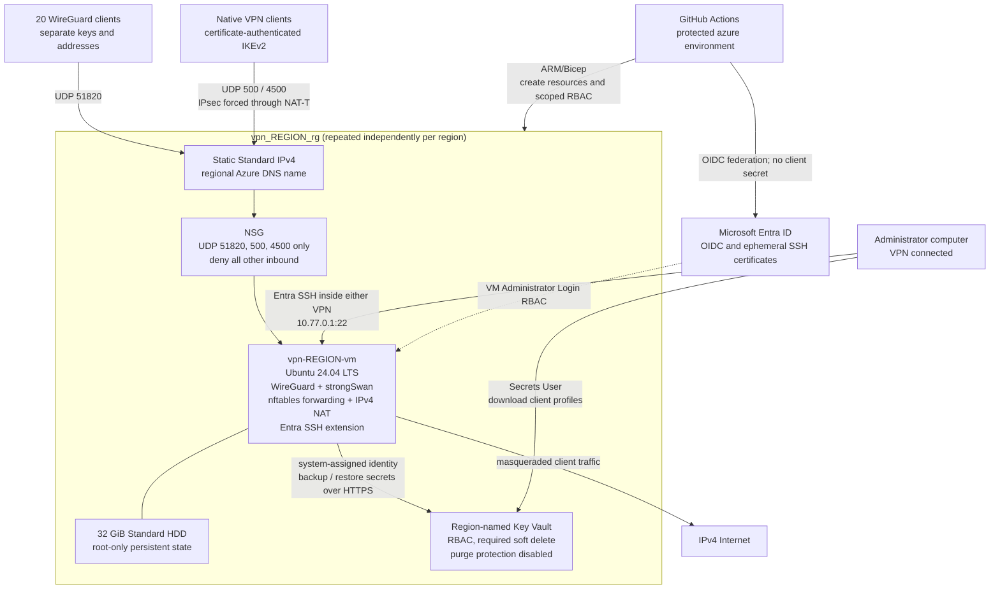
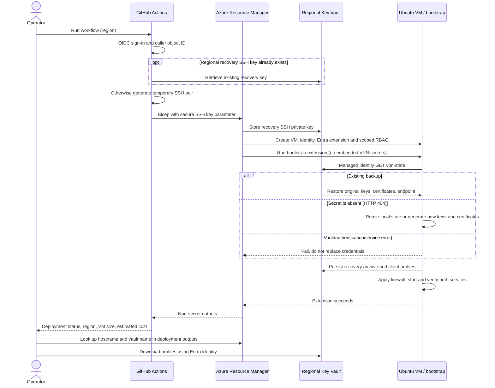

# Architecture

## One independent stack per region

Denmark East (`denmarkeast`) is the default workflow selection: its resource group is `vpn_denmarkeast_rg` and its VM is `vpn-denmarkeast-vm`. Other selected regions remain independent stacks.

The Standard public IP supplies explicit outbound connectivity even though default subnet outbound access is disabled. IP forwarding is enabled on both the NIC and in Linux. No Azure route table is needed for remote-access clients: their traffic is decrypted and NATed on the appliance.

The host firewall permits SSH only from authenticated VPN traffic. IKEv2 SSH/forwarding rules require an inbound IPsec policy (reqid 1), not just a source address. VPN clients cannot forward to Azure metadata, Azure platform DNS, or private network ranges; this appliance is for Internet access, not lateral access to Azure workloads. IPv6 forwarding is denied.

| Network | Purpose |
| --- | --- |
| `10.76.0.0/24` | Azure subnet, one NIC |
| `10.77.0.0/24`, `fd77::/64` | WireGuard; server `.1` / `::1`, 20 clients `.2`-`.21` / `::2`-`::15` (hexadecimal) |
| `10.78.0.1`-`10.78.0.20`, `fd78::1`-`fd78::14` | 20 IKEv2 client leases per address family (IPv6 endpoint `14` is hexadecimal) |

These allocations do not overlap. The Azure subnet (`10.76.0.0/24`), WireGuard subnet (`10.77.0.0/24`), and IKEv2 IPv4 pool in `10.78.0.0/24` have different third octets. WireGuard's `fd77::/64` and IKEv2's `fd78::1`-`fd78::14` also have different IPv6 prefixes. WireGuard's 20 peers use distinct host addresses and exclude its server address; IKEv2 leases a separate address to each active connection.

Both kinds of client intentionally request default routes (`0.0.0.0/0`, `::/0`) for full-tunnel operation. These are client routing policies, not overlapping server-side address allocations. WireGuard's server peer `AllowedIPs` are disjoint host prefixes, while strongSwan installs IPsec policies for the separate IKEv2 leases.

The portable regression tests derive these ranges from rendered server/client configurations and the Bicep Azure subnet. They verify IPv4/IPv6 separation, address containment, uniqueness, server exclusion, peer bindings, and exactly 20 leases per IKEv2 pool. The same validator must reject deliberately colliding IPv4/IPv6 pools and duplicate WireGuard client addresses. Linux tests additionally exercise all 20 WireGuard handshakes and 20 simultaneous IKEv2 tunnels with traffic.

IKEv2 permits concurrent connections with the shared `vpn-client` identity and ignores identity-based replacement requests from other copies of the profile. The 20-address pools bound simultaneous client leases; devices behind one NAT receive separate leases based on their translated endpoints. A copied profile is a shared credential, not an individually revocable device identity.

WireGuard provisions 20 distinct peers, each with a separate private key, preshared key, and IPv4/IPv6 address. Key Vault stores only numbered profile secrets `wireguard-client-01-config` through `wireguard-client-20-config`. The recovery archive includes all 20 peer credentials in the required `wireguard-clients.json`. Recovery uses the complete current state; missing or conflicting credentials cause a failure, never automatic conversion or replacement.

The device-neutral `ikev2-client-profile` secret contains an Apple configuration profile named `ikev2-vpn.mobileconfig`, displayed as **IKEv2 VPN &lt;regional hostname&gt;**. The file format is Apple-specific even though IKEv2 is not.

VM resource and Linux host names include the region (`vpn-<region>-vm`). Resource groups use underscore delimiters (`vpn_<region>_rg`). Vault names combine `vpn-`, the first 12 region characters, and a seven-character uniqueness suffix, remaining within Azure's 24-character limit. Key Vault requires hyphens rather than underscores. There are no resource-renaming or credential-format conversion paths.

Purge protection is disabled for new vaults. Azure requires soft delete, so the template uses its minimum seven-day retention; an authorized operator can purge a deleted vault immediately. Deployment never purges, recovers, or replaces an old vault automatically.

This proves separation inside one appliance, not against every possible client LAN. Avoid overlapping client LAN ranges. Address spaces are intentionally fixed to minimize parameters; change the Bicep/bootstrap together if your environment requires other ranges. Regions are not peered and intentionally reuse these ranges; do not activate multiple regional VPNs on the same client at once.

## Provisioning and secret lifecycle

Secrets are generated on the VM except the recovery SSH key, which exists temporarily on the GitHub runner and is passed as a secure ARM parameter. Runner files use mode 0600 and are removed on exit. The VM keeps root-only operational credentials on its encrypted-at-rest managed disk. Key Vault stores the recovery material; neither ARM outputs nor GitHub artifacts contain credentials.

The VM and workflow identity have **Secrets Officer only on this vault**. The administrator has **Secrets User on this vault** and **VM Administrator Login on this VM**. All of these are high-trust identities: the vault contains CA and client private keys, and the workflow can execute root code on the VM. Key Vault's public HTTPS endpoint is enabled to avoid Private Endpoint/DNS costs; access is authenticated with Entra RBAC, not anonymous or shared-key access.

This design deliberately favors low cost over high availability and enterprise PKI separation. A compromised VM can read its regional recovery credentials and CA key. There is no offline CA, HSM, centralized log collection, automated VPN credential rotation, or availability SLA for a single VM. Unattended security-update reboots briefly interrupt service.
